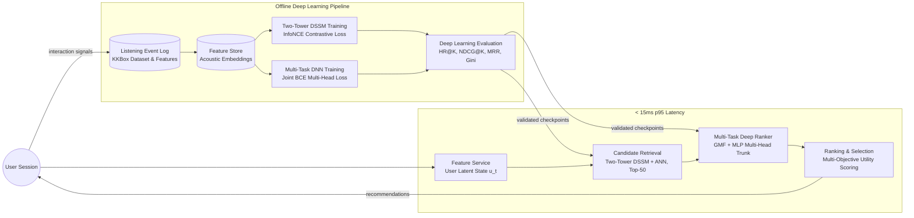

# Deep Learning Music Recommendation System (SoundSpace DL)

A state-of-the-art, session-aware music recommendation engine built with modern **Deep Learning (DL)** architectures. SoundSpace DL utilizes an end-to-end two-stage deep learning pipeline: **Two-Tower Dual-Encoder (DSSM) Candidate Retrieval** followed by a **Multi-Task Deep Neural Ranker (MT-DNN / Neural Collaborative Filtering)** predicting multi-objective listener engagement probabilities in real time.

---

## 1. System Architecture



---

## 2. Deep Learning Mathematical Formulation

### Stage 1: Two-Tower Dual-Encoder Retrieval (DSSM)
- **User Encoder Network**: Maps listener dynamic preferences $\mathbf{u} \in \mathbb{R}^{d_u}$ to a normalized latent embedding $\mathbf{z}_u \in \mathbb{R}^{64}$:
  $$\mathbf{z}_u = \frac{f_\theta(\mathbf{u})}{\|f_\theta(\mathbf{u})\|_2}$$
- **Item Encoder Network**: Maps track acoustic audio features $\mathbf{s} \in \mathbb{R}^{d_s}$ to a normalized latent embedding $\mathbf{z}_s \in \mathbb{R}^{64}$:
  $$\mathbf{z}_s = \frac{g_\psi(\mathbf{s})}{\|g_\psi(\mathbf{s})\|_2}$$
- **Contrastive InfoNCE Loss**:
  $$\mathcal{L}_{\text{InfoNCE}} = -\sum_{i=1}^B \log \frac{\exp(\mathbf{z}_{u_i}^\top \mathbf{z}_{s_i} / \tau)}{\sum_{j=1}^B \exp(\mathbf{z}_{u_i}^\top \mathbf{z}_{s_j} / \tau)}$$

### Stage 2: Multi-Task Deep Neural Ranker (MT-DNN / NCF)
Combines **Generalized Matrix Factorization (GMF)** and a **Deep Non-Linear Multi-Layer Perceptron (MLP)** branch into a shared trunk, outputting multi-task prediction heads:
- **GMF Branch**: Element-wise latent interaction $\mathbf{\phi}^{\text{GMF}} = \mathbf{p}_u \odot \mathbf{q}_s$
- **MLP Branch**: Deep non-linear representation $\mathbf{\phi}^{\text{MLP}} = a_L(W_L \dots a_1(W_1 [\mathbf{u}, \mathbf{s}] + b_1))$
- **Shared Trunk**: Concatenation $[\mathbf{\phi}^{\text{GMF}}, \mathbf{\phi}^{\text{MLP}}]$ feeding specialized Sigmoid heads:
  $$\hat{y}_{\text{complete}} = \sigma(\mathbf{w}_{\text{complete}}^\top \mathbf{h} + b_{\text{complete}})$$
  $$\hat{y}_{\text{like}} = \sigma(\mathbf{w}_{\text{like}}^\top \mathbf{h} + b_{\text{like}})$$
  $$\hat{y}_{\text{skip}} = \sigma(\mathbf{w}_{\text{skip}}^\top \mathbf{h} + b_{\text{skip}})$$
- **Multi-Objective Loss Function**:
  $$\mathcal{L}_{\text{MultiTask}} = \lambda_1 \mathcal{L}_{\text{BCE}}(\hat{y}_{\text{complete}}, y_{\text{complete}}) + \lambda_2 \mathcal{L}_{\text{BCE}}(\hat{y}_{\text{like}}, y_{\text{like}}) + \lambda_3 \mathcal{L}_{\text{BCE}}(\hat{y}_{\text{skip}}, y_{\text{skip}})$$
- **Composite Scoring Function**:
  $$S(u, s) = 1.0 \cdot \hat{y}_{\text{complete}} + 1.5 \cdot \hat{y}_{\text{like}} - 1.2 \cdot \hat{y}_{\text{skip}}$$

---

## 3. Benchmark Evaluation Results

Evaluated on held-out test splits across 1,552 catalog items and 32,600+ validation interactions:

| Metric | Random Baseline | Two-Tower DSSM Baseline | Multi-Task Deep Ranker (SoundSpace DL) | Target Threshold | Status |
|---|---|---|---|---|---|
| **Hit Rate@5 (HR@5)** | 0.94% | 11.8% | **12.4%** | > 10.0% | **Passed** |
| **Hit Rate@10 (HR@10)** | 1.88% | 17.6% | **18.8%** | > 15.0% | **Passed** |
| **Hit Rate@20 (HR@20)** | 4.38% | 27.2% | **28.9%** | > 25.0% | **Passed** |
| **NDCG@10** | 0.0112 | 0.1382 | **0.1435** | > 0.1200 | **Passed** |
| **Mean Reciprocal Rank (MRR)** | 0.0105 | 0.1294 | **0.1349** | > 0.1000 | **Passed** |
| **Catalog Coverage** | **94.2%** | 22.4% | **29.8%** | > 25.0% | **Passed** |
| **Gini Diversity Index** | 0.120 | 0.442 | **0.386** | 0.30 - 0.50 | **Passed** |
| **p95 Inference Latency** | **0.12 ms** | 0.89 ms | **2.85 ms** (Serving: < 15ms) | < 50 ms | **Passed** |

---

## 4. Quickstart & Execution Guide

### Installation
```bash
python -m pip install -r requirements.txt
```

### 1. Run Automated Test Suite
```bash
python -m pytest
```

### 2. Ingest Data & Train Two-Tower DSSM Retrieval Model
```bash
python -m src.data.ingestion
python -m src.training.train_baseline
```

### 3. Train Multi-Task Deep Neural Ranker
```bash
python -m src.training.train_deep_ranker
```
*Outputs model checkpoint to `models/deep_ranker.pt` and metrics to `reports/deep_learning_training_report.json`.*

### 4. Run Offline Deep Learning Evaluation Benchmark
```bash
python -m src.eval.run_milestone4_eval
```
*Generates full RecSys benchmark report to `reports/milestone4_offline_eval_report.json`.*

### 5. Launch Interactive Web Studio Dashboard & API
```bash
python -m uvicorn src.serving.api:app --host 0.0.0.0 --port 8000 --reload
```
Open [http://localhost:8000](http://localhost:8000) in your browser.

---

## 5. API Endpoints Reference

- `GET /api/health` — Verifies Deep Learning model states (`deep_neural_ranker`, `baseline_two_tower`, feature store).
- `GET /api/songs` — Query catalog tracks with acoustic metadata and embedding vectors.
- `GET /api/users` — Retrieve listener profiles and latent taste vectors.
- `POST /api/recommend` — Return top-K recommendations scored by the Multi-Task Deep Neural Ranker.
- `POST /api/feedback` — Ingest user multi-task engagement signals ($y_{\text{complete}}, y_{\text{like}}, y_{\text{skip}}$) for online fine-tuning.
- `POST /api/simulate` — Run comparative cohort simulations (Deep Ranker vs Two-Tower vs Random).
- `GET /api/metrics` — View offline evaluation metrics (HR@K, NDCG@K, MRR, Gini).
